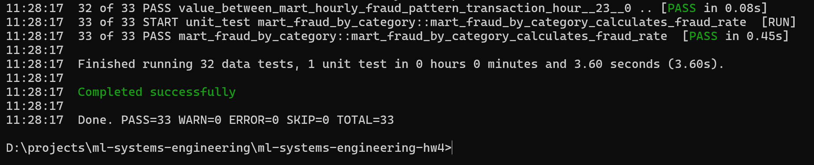
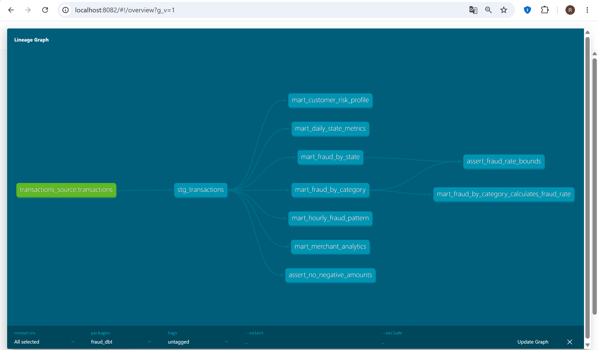

# dbt: аналитика фродовых транзакций

Домашнее задание №4 по MLOps. Проект загружает размеченные транзакции в ClickHouse и строит dbt-витрины для анализа фрода.

## Архитектура

```text
data/train.csv -> data-loader -> ClickHouse: transactions_db.transactions
                                      -> dbt: staging -> marts
```

`data-loader` однократно загружает локальный `train.csv` в raw-таблицу. dbt читает только эту таблицу как source и создаёт модели в базе `analytics`.

## Модели

- `stg_transactions`: нормализация, ключ клиента, календарные признаки и сегмент суммы через собственный макрос `amount_bucket`.
- `mart_daily_state_metrics`: дневные метрики по штатам.
- `mart_fraud_by_category`: фрод по категориям.
- `mart_fraud_by_state`: фрод по штатам.
- `mart_customer_risk_profile`: профиль риска клиента.
- `mart_hourly_fraud_pattern`: временные паттерны фрода.
- `mart_merchant_analytics`: аналитика мерчантов.

Подключены `dbt_utils`, `dbt_date` и `dbt_expectations`. В проекте есть schema tests, singular tests, unit test, sqlfluff, pre-commit и Makefile.

## Версии

- `dbt-core 1.8.10`
- `dbt-clickhouse 1.8.9`

## Данные

Положите размеченный `train.csv` в `data/train.csv`. Датасет исключён из Git из-за размера.

## Запуск

```powershell
docker compose up -d --build
docker compose ps
```

Дождитесь статуса `healthy` у ClickHouse и завершения `data-loader` с кодом `0`.

## dbt-команды

```powershell
docker compose exec dbt dbt deps
docker compose exec dbt dbt run
docker compose exec dbt dbt test
```

Проверить source:

```powershell
docker compose exec dbt dbt debug
docker compose exec -T clickhouse clickhouse-client --user default --password fraud_dbt_password --query "SELECT count() FROM transactions_db.transactions"
```

Сгенерировать документацию:

```powershell
docker compose exec dbt dbt docs generate
docker compose exec -d dbt dbt docs serve --host 0.0.0.0 --port 8082
```

Документация будет доступна на [http://localhost:8082](http://localhost:8082).

## Проверки качества

```powershell
docker compose exec dbt dbt test --select test_type:unit
docker compose exec dbt dbt test --select test_type:data
docker compose exec dbt sqlfluff lint models tests
```

`make up`, `make deps`, `make run`, `make test`, `make docs` и `make lint` повторяют основные команды.

## Подтверждение проверок

Полный запуск `dbt test`: 32 data tests и 1 unit test завершились без ошибок.



Граф зависимостей показывает путь от source через staging-слой к шести витринам.



## Остановка

```powershell
docker compose down
```

Для полного сброса ClickHouse-данных:

```powershell
docker compose down -v
```
